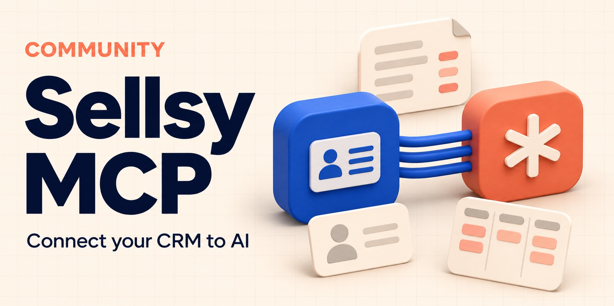

# Sellsy MCP Community



A self-hosted [Model Context Protocol](https://modelcontextprotocol.io/) server for
[Sellsy API v2](https://docs.sellsy.com/api/v2/). Connect an MCP client to your CRM
using each person's own Sellsy identity.

**Community beta.** Maintained by BoucheCousue; not an official Sellsy product and
not affiliated with or endorsed by Sellsy. [Présentation en français](docs/fr.md).

## What it does

- 42 tools for companies, contacts, items, estimates, invoices, opportunities,
  subscriptions, related documents, comments and files.
- Native search, bounded pagination and explicit incomplete-result reporting.
- Sales history with document-line evidence and optional purchase-cost previews.
- Optional estimate and opportunity writes through separate `prepare` / `apply`
  tools: per-user manifests, expiry, concurrency checks and readback verification.
- OAuth with PKCE, separate MCP and Sellsy tokens, encrypted upstream credentials,
  rotating MCP refresh tokens and local administration commands.
- Shared read throttling after rate limits; business writes are not automatically retried.

Writes are **disabled by default**. This release is intended for one organization
per deployment, with multiple individual staff accounts. It is not an audited
public multi-organization hosting service.

## Quick start

Requirements: Python 3.11+ and [uv](https://docs.astral.sh/uv/). Create your own
Sellsy **Private** OAuth application with authorization-code flow, PKCE, refresh
tokens, the scopes listed in `.env.example` and your exact callback URL.

The server uses the official **MCP Python SDK 2.3+** (`MCPServer`). See the
[SDK v2 migration notes](docs/sdk-v2.md) when upgrading an existing instance.

```sh
git clone https://github.com/bouchecousue/sellsy-mcp.git
cd sellsy-mcp
cp .env.example .env
chmod 600 .env
# Edit .env: credentials, HTTPS public origin, callback allowlist.
uv sync --frozen --no-dev
uv run --frozen --no-dev sellsy-mcp
```

Use a reverse proxy or tunnel for TLS. Forward the **whole origin**, including
OAuth and discovery routes, to `127.0.0.1:8766`. The callback is:

```text
https://YOUR-MCP-HOST/oauth/callback
```

The MCP endpoint is `https://YOUR-MCP-HOST/mcp`. Anonymous calls return HTTP 401
with OAuth discovery metadata. `/health/ready` checks the service and storage;
use the authenticated `sellsy_get_capabilities` tool to check actual Sellsy access.

For containers, configure `.env` first, then run:

```sh
docker compose up --build -d
docker compose exec sellsy-mcp sellsy-mcp-admin grants
```

The Compose example publishes loopback only. See [deployment](docs/deployment.md)
for Docker, Linux/systemd, persistence, backups and reverse-proxy requirements.

## Connecting an MCP client

Use a client supporting remote Streamable HTTP and OAuth discovery/dynamic client
registration. Add your HTTPS `/mcp` endpoint, sign in to Sellsy, then inspect
`sellsy_get_capabilities`. Tool descriptions and most operational messages are in French.

The original integration has been exercised with ChatGPT. This community beta's
tests simulate OAuth and business HTTP; they do not certify every client or every
Sellsy plan. See [configuration and OAuth](docs/configuration.md) for callback
allowlists and reconnecting after scope changes.

## Enabling writes

1. Set `SELLSY_MCP_ENABLE_WRITES=true` and restart your instance.
2. Reconnect the MCP client and approve both `sellsy.write` and the relevant Sellsy
   scopes (`estimates.write` / `opportunities.write`).
3. Request `prepare_*`, review its diff, explicitly approve it, then request the
   corresponding `apply_*` with `approved=true`.
4. Inspect the persisted result and readback. Never replay an uncertain write.

The calling application must collect the user's approval. An `approved` boolean
is an API contract, not an independent human-approval interface or sandbox.

## Documentation

- [Tool catalog](docs/tools.md)
- [Configuration and OAuth troubleshooting](docs/configuration.md)
- [Deployment and administration](docs/deployment.md)
- [Security model and limitations](docs/security-model.md)
- [Contributing and tests](CONTRIBUTING.md)
- [Report a security issue privately](SECURITY.md)
- [Changelog](CHANGELOG.md)

## License and attribution

[MIT](LICENSE). Copyright 2026 BoucheCousue and contributors.
This repository starts with a clean source snapshot; it contains no production
state or private deployment history. Dependencies retain their own licenses; see
[third-party notices](THIRD_PARTY_NOTICES.md).
