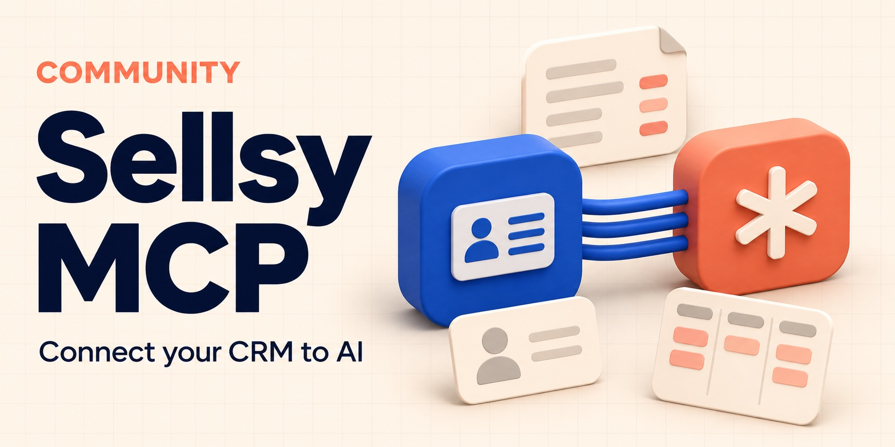

# Sellsy MCP communautaire

Ce serveur permet à un client MCP d'interroger Sellsy avec l'identité et les droits
de chaque collaborateur. Il est proposé par BoucheCousue sous licence MIT.
Ce n'est pas un produit officiel Sellsy.

Il comprend 42 outils : recherche, clients, contacts, devis, factures,
opportunités, abonnements et fichiers. Les écritures sont désactivées par défaut.
Leur activation demande une configuration explicite, un consentement OAuth, puis
une préparation et une application distinctes, avec relecture du résultat.

Chaque entreprise héberge sa propre instance et crée son client OAuth Sellsy.
Cette bêta n'est pas une offre d'hébergement public pour plusieurs entreprises.
Les descriptions d'outils et la plupart des messages sont en français.

Consulter le [guide de démarrage](../README.md), la [configuration](configuration.md),
le [déploiement](deployment.md) et les [limites de sécurité](security-model.md).
Les tests fonctionnent sans identifiants et sans appel à un compte Sellsy réel.
